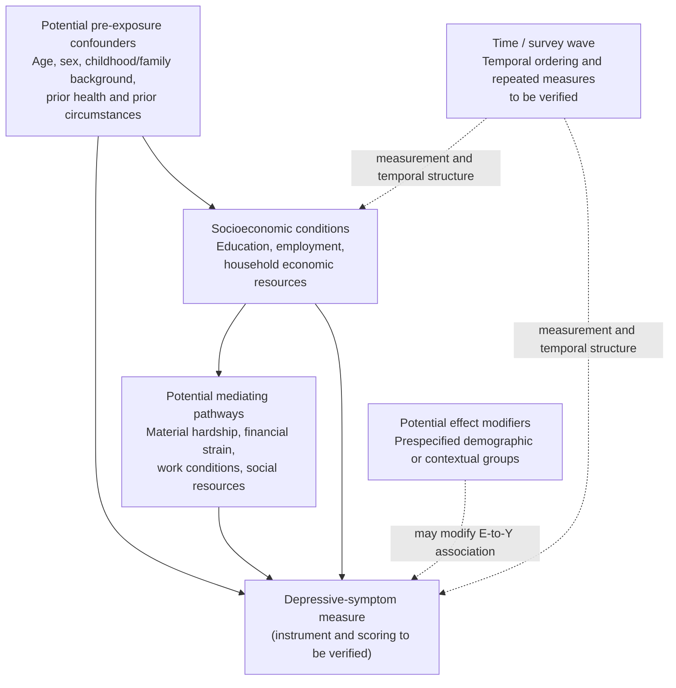

# Conceptual Framework and Directed Acyclic Graph (DAG)

**Status:** Provisional conceptual model. The diagram represents hypothesized relationships for research planning; it is not evidence that any pathway is present in IFLS data and is not, by itself, a causal identification strategy.

## 1. Conceptual Overview

This study examines how socioeconomic conditions may be associated with depressive symptoms among eligible Indonesian adults.

The core exposure domains under consideration are education, employment, and household economic resources. These domains are related but not interchangeable. They may operate through material and psychosocial pathways, while prior demographic, family, and health circumstances may influence both socioeconomic position and mental health.

The final framework must be revised after reviewing the relevant literature, temporal ordering, IFLS questionnaires, and verified variable definitions.

## 2. Working Conceptual Diagram

The diagram below is a hypothesis map. Arrows indicate hypothesized direction, not confirmed causal effects.

## 3. Construct Roles

### 3.1 Exposures

Candidate socioeconomic exposure domains:

- **Education:** highest completed educational level or another verified educational attainment measure.
- **Employment:** employment participation, status, or characteristics, depending on the survey items.
- **Household economic resources:** an appropriately documented income, expenditure, consumption, or asset measure, if available.

Each exposure requires a precise operational definition, reference period, coding scheme, and justification. Household-level measures must not automatically be interpreted as individual resources.

### 3.2 Outcome

The intended outcome is a documented measure of depressive symptoms. CES-D is a candidate only until its presence, item wording, respondent eligibility, scoring, and wave comparability are confirmed.

A symptom score is not equivalent to a clinical diagnosis. The primary outcome scale and direction must be stated explicitly in the final protocol.

### 3.3 Potential Confounders

Potential confounders are variables that plausibly precede the exposure of interest and influence both that exposure and the outcome. Candidate domains for literature review include:

- Age and sex.
- Childhood socioeconomic and family background.
- Early-life circumstances.
- Prior health conditions or prior mental-health status.
- Geographic and contextual conditions that precede the exposure period.

These are candidate domains, not a final adjustment set. Their relevance depends on the exposure, estimand, temporal ordering, and actual IFLS measurements. A variable should not be adjusted for merely because it is available.

### 3.4 Potential Mediators

Potential mediating pathways may include:

- Material hardship and financial strain.
- Housing or living conditions.
- Work conditions and job insecurity.
- Social support and social resources.

These variables may lie on the pathway between socioeconomic conditions and depressive symptoms. If the target is a total association or total causal effect, adjusting for a mediator can remove part of the pathway of interest. Mediation analysis would require a separately specified estimand and stronger assumptions.

### 3.5 Potential Effect Modifiers

The association may differ across selected groups or contexts. Age, sex, urban/rural context, or other theoretically justified factors may be considered as effect modifiers only where the data support reliable subgroup or interaction analyses.

Effect modification is distinct from confounding: it concerns variation in the exposure-outcome association across levels of another variable.

## 4. Estimand Must Be Explicit

The project must distinguish at least three possible targets:

1. **Cross-sectional adjusted association:** the difference in depressive-symptom score associated with differences in socioeconomic conditions at a specified wave.
2. **Longitudinal between-person association:** whether individuals with different socioeconomic trajectories also differ in depressive-symptom trajectories.
3. **Within-person association:** whether changes in a person's socioeconomic circumstances correspond to changes in that person's depressive-symptom score over time.

These targets are not interchangeable. The third requires valid respondent linkage, repeated measures, appropriate temporal ordering, and comparable measurement. None should be described as a causal effect without a defensible identification strategy.

## 5. Implications for Statistical Adjustment

- Define the exposure and estimand before selecting covariates.
- Use subject-matter reasoning and a documented causal diagram to select a minimally sufficient adjustment set where causal interpretation is intended.
- For associational models, clearly label adjusted estimates and explain the covariate rationale.
- Do not automatically adjust for potential mediators when estimating a total association.
- Avoid conditioning on colliders or variables affected by both exposure and outcome processes.
- Consider prior outcome values in longitudinal models only with a clear estimand and model rationale; adjustment can change the interpretation of the exposure coefficient.
- Assess whether survey design, clustering, weights, repeated observations, and attrition affect estimation and uncertainty.

## 6. Assumptions and Limitations

The current diagram is deliberately broad. It does not establish:

- That all candidate constructs are measured in IFLS4 or IFLS5.
- That measurements have equivalent meanings or scales across waves.
- That the proposed temporal order is supported by survey timing.
- That all important confounders are observed.
- That measurement error, reverse causation, selection, or attrition are negligible.
- That statistical adjustment is sufficient for causal identification.

Unmeasured confounding, reverse causation, measurement error, selection bias, and differential attrition remain possible threats. These should be addressed through design decisions, sensitivity analyses, and cautious interpretation where feasible.

## 7. Data-Audit Requirements

Before this framework is finalized:

1. Identify the exact outcome instrument, eligible respondents, item set, and scoring protocol in each candidate wave.
2. Verify candidate socioeconomic measures, units, reference periods, and missing-value codes.
3. Establish respondent-level linkage and the timing of repeated observations.
4. Identify survey weights, strata, clusters, and geographic identifiers relevant to the planned estimand.
5. Review whether candidate confounders precede the exposure period.
6. Determine whether proposed mediators and effect modifiers are actually measured and adequately powered.
7. Record any construct that cannot be operationalized and remove or revise it rather than assuming availability.

## 8. Status and Next Step

This framework is provisional. The next step is to create a variable-domain inventory that maps each conceptual construct to candidate IFLS files, questionnaire sections, variable names, wave availability, and verification status. No variable should enter the analysis dataset until that mapping is supported by the official documentation and data.
